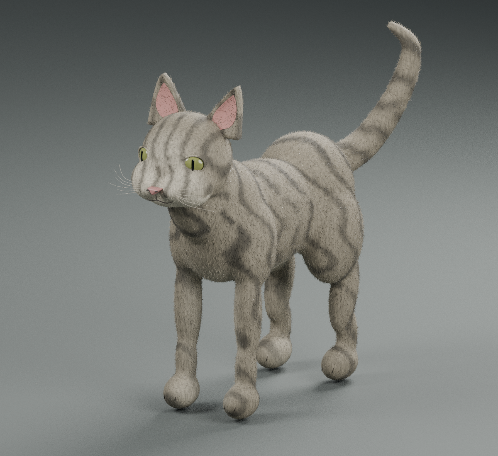
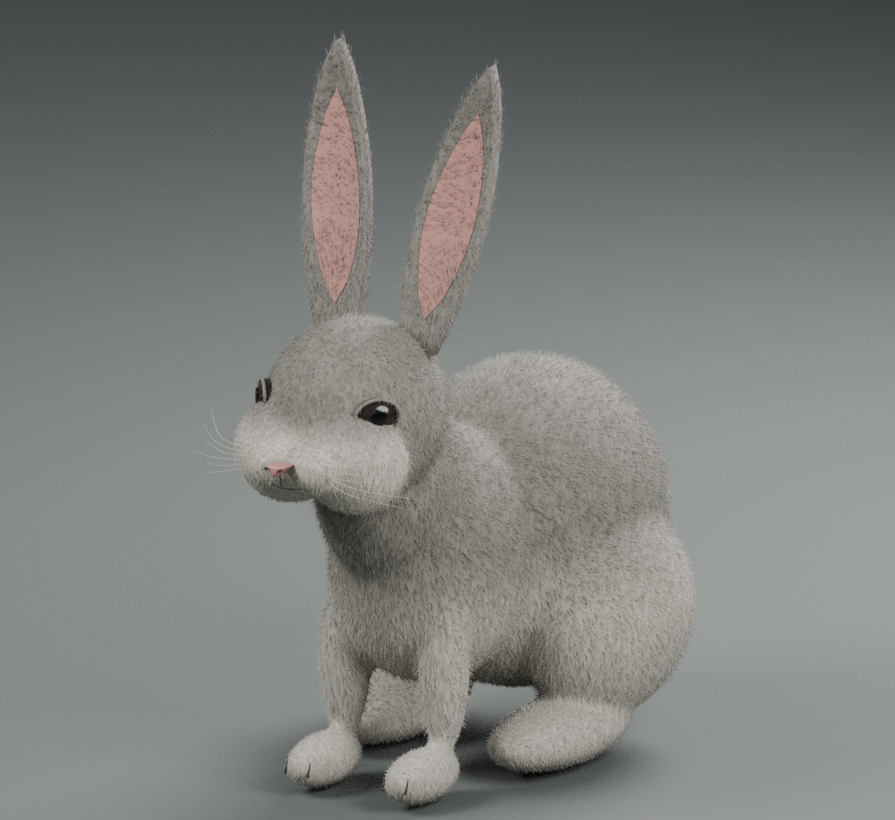
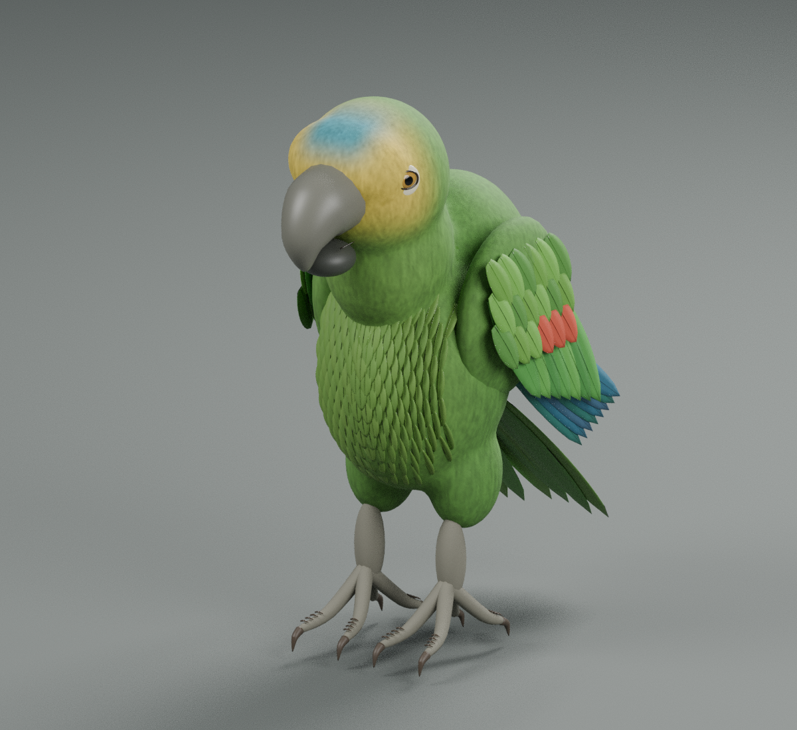
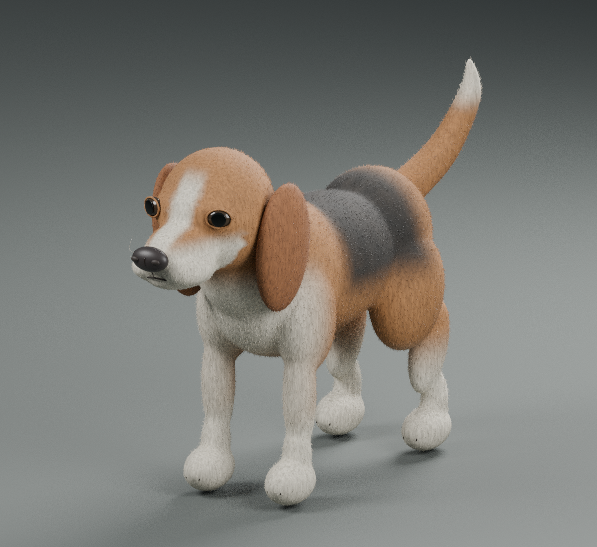
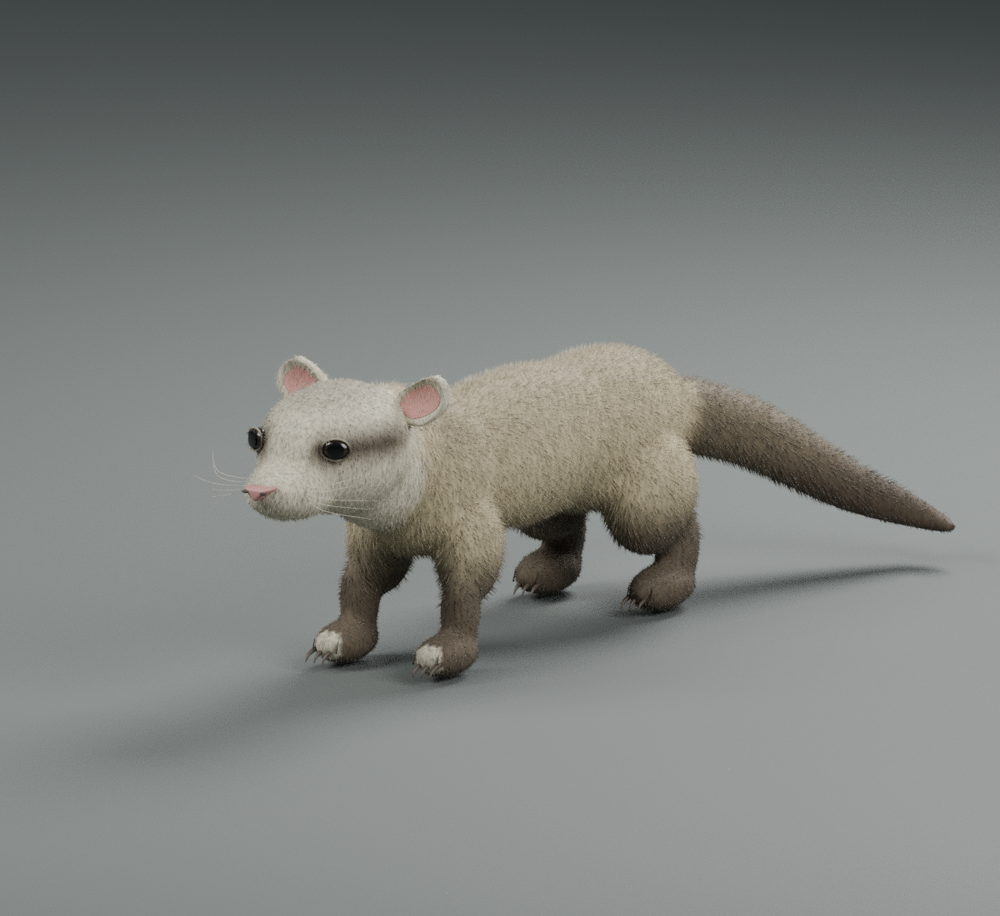

# Animais — coleção naturalista

Cinco modelos originais com proporções mais naturais, texturas PBR e detalhes de pelos ou penas. Esta edição prioriza a aparência, sem o limite de polígonos do primeiro cachorrinho.

Os modelos são estáticos, sem rig ou animações. Os mamíferos incluem pelos em geometria; o papagaio inclui penas sobrepostas. As prévias são renders dos próprios modelos.

## Downloads

Cada ZIP inclui FBX, fonte editável Blender, texturas, prévia e instruções. No GitHub, abra o arquivo e use **Download raw file**, ou os links diretos abaixo.

| Animal | Pacote completo | FBX | Triângulos |
| --- | --- | --- | ---: |
| Gato tigrado | [Baixar ZIP](https://github.com/oTalDoWaaase/Models/raw/refs/heads/assets/animais-naturalistas/assets/realistic_pets/packages/Gato_Tigrado.zip) | [Baixar FBX](https://github.com/oTalDoWaaase/Models/raw/refs/heads/assets/animais-naturalistas/assets/realistic_pets/Gato_Tigrado/Gato_Tigrado.fbx) | 637,928 |
| Coelho cinza | [Baixar ZIP](https://github.com/oTalDoWaaase/Models/raw/refs/heads/assets/animais-naturalistas/assets/realistic_pets/packages/Coelho_Cinza.zip) | [Baixar FBX](https://github.com/oTalDoWaaase/Models/raw/refs/heads/assets/animais-naturalistas/assets/realistic_pets/Coelho_Cinza/Coelho_Cinza.fbx) | 637,756 |
| Papagaio | [Baixar ZIP](https://github.com/oTalDoWaaase/Models/raw/refs/heads/assets/animais-naturalistas/assets/realistic_pets/packages/Papagaio_Amazonas.zip) | [Baixar FBX](https://github.com/oTalDoWaaase/Models/raw/refs/heads/assets/animais-naturalistas/assets/realistic_pets/Papagaio_Amazonas/Papagaio_Amazonas.fbx) | 120,092 |
| Cachorro beagle | [Baixar ZIP](https://github.com/oTalDoWaaase/Models/raw/refs/heads/assets/animais-naturalistas/assets/realistic_pets/packages/Cachorro_Beagle.zip) | [Baixar FBX](https://github.com/oTalDoWaaase/Models/raw/refs/heads/assets/animais-naturalistas/assets/realistic_pets/Cachorro_Beagle/Cachorro_Beagle.fbx) | 460,408 |
| Furão | [Baixar ZIP](https://github.com/oTalDoWaaase/Models/raw/refs/heads/assets/animais-naturalistas/assets/realistic_pets/packages/Furao_Sable.zip) | [Baixar FBX](https://github.com/oTalDoWaaase/Models/raw/refs/heads/assets/animais-naturalistas/assets/realistic_pets/Furao_Sable/Furao_Sable.fbx) | 518,596 |

## Prévias

### Gato tigrado

### Coelho cinza

### Papagaio

### Cachorro beagle

### Furão

## Verificação

Os cinco arquivos FBX foram reimportados no Blender e conferidos: número de malhas e triângulos, coordenadas finitas, UVs e leitura das texturas. Os pacotes ZIP também tiveram sua integridade verificada.

Scripts de geração e validação: `tools/create_realistic_pets.py` e `tools/validate_realistic_pets.py`, na raiz do repositório.
